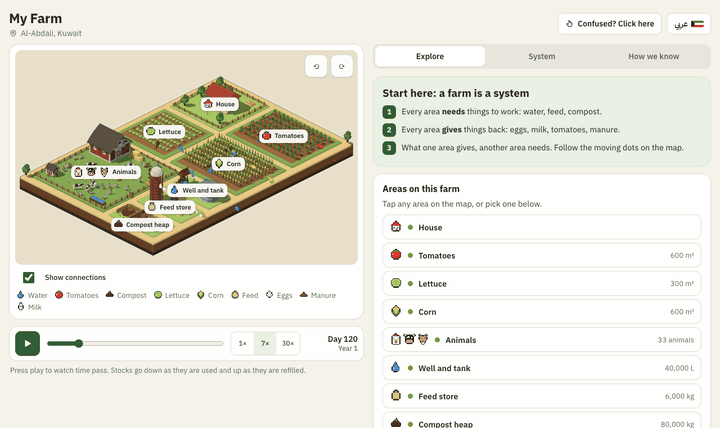

<div dir="rtl">

# ليرن فارم (LearnFarm) 🌱

[English](README.md) · **العربية**

<p align="center"></p>

<p align="center"><a href="https://yusufmufeed.uk/learnfarm?lang=ar"><b>الموقع والعرض الحي: yusufmufeed.uk/learnfarm</b></a></p>

**تعلّم الزراعة بالحديث مع مساعدك البرمجي، وشاهد المزرعة تتحرك أمامك أثناء الحديث.**

ليرن فارم مجموعة مهارات مجانية ومفتوحة المصدر، ومعها محاكاة حيّة لمزرعة ثلاثية الأبعاد. اسأل مساعدك (Claude Code أو Codex أو Cursor أو Gemini CLI): *"ماذا تحتاج دجاجة واحدة طوال حياتها؟"* فيظهر قنّ دجاج بجانب المحادثة: العلف يدخل، والبيض يخرج، والأيام تمضي أمام عينيك.

وعندما تكون جاهزًا، أخبره بمدينتك وميزانيتك والمساحة المتاحة لديك، فيعطيك ثلاث طرق واقعية لبدء مزرعتك الخاصة، بما فيها الزراعة العمودية. ولكل طريقة تكلفتها وإنتاجها المتوقع ومدة استرداد رأس المال والمخاطر.

> **الحالة: المرحلة 1 (نموذج الدجاجة الأول).** العارض ثلاثي الأبعاد ومحرّك الحسابات ومهارة Claude Code تعمل اليوم. تابعنا أو افتح Issue.

## التثبيت (أي مساعد، سطر واحد)

```bash
npx skills add BenjisCollector/learnfarm
```

يثبّت هذا معلّم الزراعة في Claude Code وCodex وGitHub Copilot وCursor وGemini CLI وWarp وAmp وأكثر من عشرة مساعدات أخرى. ثم اسأل مساعدك أي شيء: *"ماذا تحتاج دجاجة واحدة في اليوم؟"*، *"ماذا يحدث إذا توقفت مضخة البئر؟"*. في أي مشروع يعلّمك بنفس الأرقام الموثّقة، وداخل هذا المستودع يحرّك المزرعة الحية أيضًا.

بلا مساعد: افتح المزرعة الحية في أي متصفح: [yusufmufeed.uk/learnfarm](https://yusufmufeed.uk/learnfarm?lang=ar)

## كيف يعمل

```
أنت ⇄ مساعدك البرمجي ── يحمّل مهارات ليرن فارم
              │
              ▼
        خادم MCP الخاص بليرن فارم ──► محرك المحاكاة (نماذج محاصيل ومناخ حقيقية)
              │
              └── scene.json ──► العارض ثلاثي الأبعاد (لوحة جانبية، أو تبويب متصفح، أو داخل Claude/ChatGPT)
```

## القاعدة الأولى: الذكاء الاصطناعي لا يخترع الأرقام

كل رقم (المحصول، الماء، التكلفة) يأتي من نموذج حسابي ثابت أو من بيانات منشورة، ويحمل مصدره (`source`). المساعد يشرح، والمحرك يحسب.

## ثنائي اللغة من اليوم الأول

كل اسم ووصف في المشهد له نسخة إنجليزية وعربية (`{"en": "...", "ar": "..."}`).

## خارطة الطريق

| المرحلة | ما سيُطلق | الحالة |
|---|---|---|
| 0–1 | الأساسات، محرك معدلات بمصادر، أول عارض بكسل، الموقع | ✅ |
| **A** | **محرك النظام**: مخزونات، وروابط بين الأجزاء (السماد ← الكمبوست ← الحقول)، ونقص الموارد، والمساحات | ✅ |
| **B** | **مجسّم ثلاثي الأبعاد**: مزرعة ثلاثية الأبعاد بأيقونات مكعّبة تظهر فيها التدفقات بين الأجزاء | ✅ |
| **C** | **مسار تعليمي**: خريطة مفاهيم، وتقدّم محفوظ، ودروس تتكيّف معك | 📋 |
| D | تحدّي المزرعة: لعبة القرارات | 📋 |
| E | العالم الحقيقي: طقس حي، ونماذج محاصيل، وأثر الحرارة | 📋 |
| F | المخطِّط: مدينتك وميزانيتك ومساحتك، بما فيها الزراعة العمودية | 📋 |
| G | الإطلاق: واجهة داخل المحادثة، وحزم الخليج، والمجتمع | 📋 |

التفاصيل ومعيار الإنجاز لكل مرحلة في [ROADMAP.md](ROADMAP.md)، والقرارات في [DECISIONS.md](DECISIONS.md).

## شغّلها

```bash
python3 -m http.server 5173
```

افتح http://localhost:5173/viewer/ بجانب Claude Code وهو مفتوح داخل هذا المستودع. يقرأ العارض ملف `examples/farm.scene.json` كل ثانية. قل "أضف ١٦ دجاجة واجعلها تمطر": مهارة `learnfarm` ([skills/learnfarm/SKILL.md](skills/learnfarm/SKILL.md)) تعدّل المشهد وتشغّل المحرّك، فتتحدّث المزرعة أمامك خلال ثانية تقريباً.

## المحرّك

لا تُكتب أرقام المدخلات والمخرجات باليد. الملفان `data/animals.json` و `data/crops.json` يحملان المعدّلات لكل رأس ولكل متر مربع، وكل معدّل له مصدر في [docs/research](docs/research/README.md). المحرّك يضربها في `props.count` أو `props.area_m2`:

```bash
python3 -m engine.build examples/farm.scene.json
```

## الترخيص

الكود بترخيص [MIT](LICENSE)، والبيانات والدروس بترخيص [CC BY 4.0](DATA-LICENSE.md).


</div>
