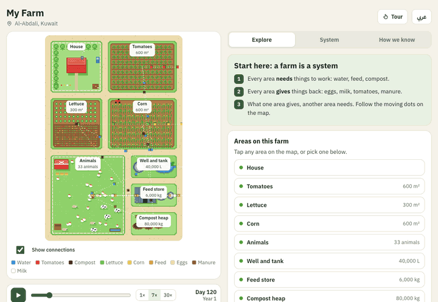

# Open Farm 🌱

**English** · [العربية](README.ar.md)

<p align="center"></p>

<p align="center"><a href="https://yusufmufeed.uk/open-farm"><b>Website and live demo: yusufmufeed.uk/open-farm</b></a></p>

**Learn farming by talking to your coding agent, and watch the farm come alive as you talk.**

Open Farm is a free, open-source skill pack plus a live 3D farm simulation. Ask your agent (Claude Code, Codex, Cursor, Gemini CLI) *"what does one chicken need for its whole life?"* and a coop appears beside your chat. Feed goes in, eggs come out, and the days tick by.

When you're ready, tell it your city, budget, and space. It gives you three realistic ways to start your own farm, including vertical farming, with costs, output, payback, and risks.

> **Status: Phase 1 (chicken MVP).** The 3D viewer, the flow engine, and the Claude Code skill run today. Follow along or open an issue.

## How it works

```
You ⇄ your coding agent ── loads the Open Farm skills
              │
              ▼
        Open Farm MCP server ──► simulation engine (real crop + climate models)
              │
              └── scene.json ──► 3D viewer (side panel, browser tab, or inside Claude/ChatGPT)
```

## Rule #1: the AI never makes up numbers

Every figure (yield, water, cost) comes from a deterministic model or published data, and it carries its `source`. The agent explains. The engine calculates.

## Bilingual from day one

Every name and label in a scene has English and Arabic (`{"en": "...", "ar": "..."}`).

## Roadmap

| Phase | What ships | Status |
|---|---|---|
| 0–1 | Foundations, sourced rate engine, first pixel viewer, website | ✅ |
| **A** | **System engine**: stocks, links between parts (manure → compost → fields), shortages, sizes | ✅ |
| **B** | **3D diorama**: 3D farm with block-style icons and visible flows between parts | ✅ |
| **C** | **Learning path**: concept map, saved progress, adaptive lessons | 📋 |
| D | Farm Challenge: the decision game | 📋 |
| E | Real world: live weather, crop models, heat effects | 📋 |
| F | Planner: your city, budget and space, including vertical farming | 📋 |
| G | Launch: in-chat UI, Gulf region packs, community | 📋 |

Details and "done when" for each phase: [ROADMAP.md](ROADMAP.md). Decisions are logged in [DECISIONS.md](DECISIONS.md).

## See it run

```bash
python3 -m http.server 5173
```

Open http://localhost:5173/viewer/ next to Claude Code, opened in this repo. The viewer re-reads `examples/farm.scene.json` every second. Say "add 16 more hens and make it rain": the `open-farm` skill ([skills/open-farm/SKILL.md](skills/open-farm/SKILL.md), linked into `.claude/skills/`) edits the scene, runs the engine, and the 3D farm updates within about a second. Load a different scene with `?scene=../examples/chicken.scene.json`.

## The engine

Flows are never typed by hand. `data/animals.json` and `data/crops.json` hold per-head and per-m² rates, each citing [docs/research](docs/research/README.md). The engine multiplies them by `props.count` or `props.area_m2`:

```bash
python3 -m engine.build examples/farm.scene.json
```

`--check` exits 1 if any flow is stale, and `--demo` runs the self-check.

The map shows every area with its size, and moving dots show what travels between them (water, feed, manure, compost). **Explore** shows what any area needs each day, where it comes from, what it gives back, and where that goes. **System** shows the whole loop and the stores: switch the well pump off, press play, and watch the farm slow down. **How we know** explains every number. Works on phone and desktop, in English and Arabic.

## The scene contract

- Schema: [`schema/scene.v0.schema.json`](schema/scene.v0.schema.json)
- Example: [`examples/chicken.scene.json`](examples/chicken.scene.json)
- Check: `python3 scripts/check_scene.py examples/*.json` and `python3 -m engine.build --check examples/*.json`

## License

Code is [MIT](LICENSE). Data and lessons are [CC BY 4.0](DATA-LICENSE.md).

*Not related to the archived OpenFarm.cc project by FarmBot (shut down April 2025).*
